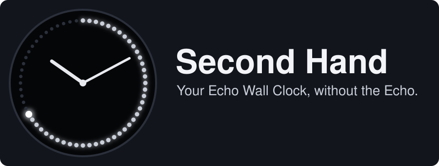
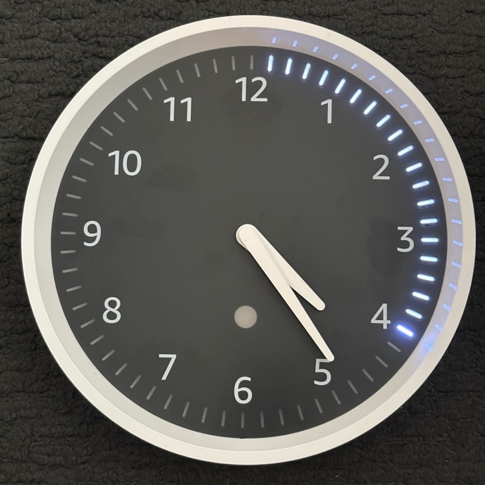
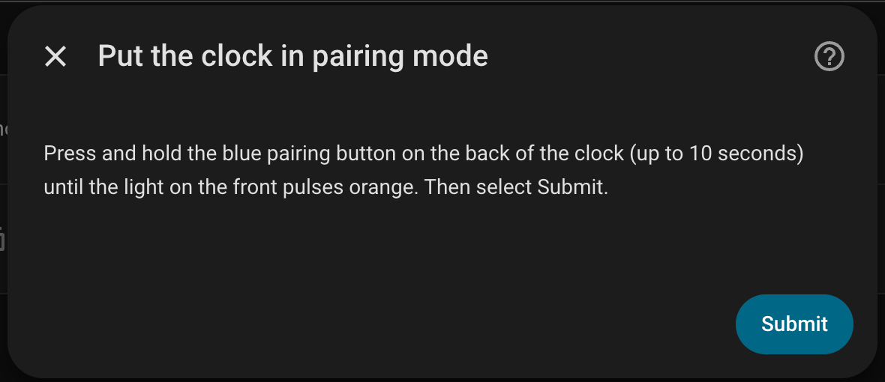
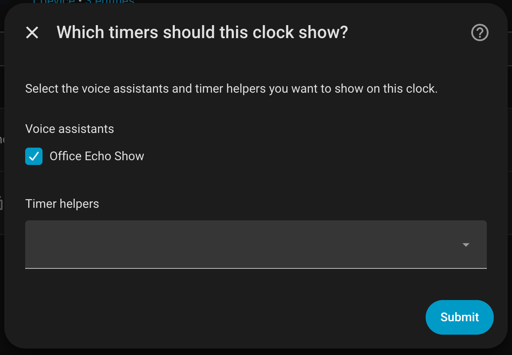

# ⏱️ Second Hand for Home Assistant

Second Hand gives your Echo Wall Clock a second life. It connects the clock straight to Home Assistant over Bluetooth, so the clock shows your timers and keeps the right time, the way it does with an Echo. The clock needs no changes.

It has a twin for kiosks, [Second Hand for Kiosk Satellite](https://github.com/mpjanofsky/second-hand-plugin). This one is for Home Assistant itself.

See what the clock shows without owning one: [try the clock simulator](https://mpjanofsky.github.io/echo-wall-clock/) in your browser.

## ✨ Features

- ⏲️ **Voice timers on the clock:** timers you start with a voice assistant (Assist) show on the clock. Pause, resume, add time or cancel and the clock follows.
- 🧰 **Timer helpers too:** Home Assistant `timer.*` helpers show on the clock, so an automation can put a countdown on your wall.
- 🔔 **A pulse when time is up:** the clock pulses when a timer ends, and clears when you cancel it.
- 🕐 **The right time:** Second Hand sets the clock's time when it connects and again every half hour, so daylight saving and time zone changes are picked up on their own.
- 🔁 **Looks after itself:** if the clock loses power or goes out of range, it reconnects on its own and puts the running timers back.
- 🔒 **Local only:** no account, no cloud, nothing to change on the clock.

You choose which voice assistants and timer helpers each clock shows. Nothing is shown by default.

## 📱 Requirements

| | |
|---|---|
| **You need** | An Echo Wall Clock, Home Assistant 2026.10.0 or newer, and a Bluetooth adapter on the Home Assistant host that supports Bluetooth Classic, within about 10 m of the clock. |
| **Tested on** | Home Assistant Container 2026.10.1 on a Raspberry Pi 3B with its built-in Bluetooth, one Echo Wall Clock, and a Kiosk Satellite voice satellite. |
| **Not tested yet** | Home Assistant OS and Supervised installs, more than one voice satellite, and runs of a day or more. |
| **Won't work** | A host with no Bluetooth (most NAS boxes, for example Synology), or too far from the clock. Bluetooth proxies (ESPHome, Shelly) can't help: they only do Bluetooth Low Energy and the clock only speaks Bluetooth Classic. |

Home Assistant in a container needs the host's Bluetooth: host networking and the host's `/run/dbus` mounted into the container.

> ⚠️ **One controller per clock.** An Echo Wall Clock connects to one device at a time. Pairing it with Second Hand disconnects it from whatever it was paired with before. To give it back, delete the Second Hand entry in **Settings > Devices & services**, which forgets the pairing, then set the clock up with your Echo again.

## 🚀 Install

1. In HACS, open the menu and choose **Custom repositories**.
2. Add `https://github.com/mpjanofsky/second-hand-integration` with the type **Integration**.
3. Find **Second Hand** in HACS, download it, and restart Home Assistant.

## 🕰️ Set up your clock

1. Go to **Settings > Devices & services > Add integration** and choose **Second Hand**.
2. Name it, then choose your Bluetooth adapter if you have more than one.
3. Press and hold the blue pairing button on the back of the clock (up to 10 seconds) until the light on the front pulses orange. That is pairing mode. Keep it pulsing, then select **Submit**.
4. Second Hand looks for the clock for up to 30 seconds. When it finds it, it asks you to confirm before pairing.
5. Pick the voice assistants and timer helpers this clock should show.

&nbsp;

Pairing can take a minute or two the first time: the first connection right after pairing often fails and Second Hand keeps trying on its own. To change the choices later, open **Settings > Devices & services > Second Hand** and choose **Configure**. The clock keeps its connection while you do.

## ⚙️ What you get

| Entity | What it is |
|---|---|
| **Connected** | On while the clock is connected. |
| **Timers** | The timers the clock should show now, with their end times in the attributes. Other integrations and automations can read it. |
| **Sync time** | Button: sets the clock's time now. |

## 🔒 Privacy

Everything stays in your Home Assistant. Second Hand reads your timers and talks to the clock over Bluetooth. It doesn't use the internet and sends nothing about you or your home anywhere.

## 🧰 Troubleshooting

| What you see | What to try |
|---|---|
| **No Bluetooth here** during setup | Home Assistant can't reach a Bluetooth Classic adapter. In a container, check host networking and the `/run/dbus` mount. Setup stops until Home Assistant can. |
| **No clock in pairing mode was found** | Hold the blue pairing button until the light pulses orange, stay within about 10 m, and try again. |
| **Connected is off** | Check the clock has batteries and nothing else has taken the pairing. After pairing, the first connection can take a few minutes. |
| The clock is stuck or won't connect | Take a battery out for about 10 seconds, put it back, put the clock in pairing mode again and pair from Home Assistant. |
| The clock stays blank | Check that the voice assistant or helper that has your timer is picked in the integration's options. |

## 🙏 Credits

The Echo Wall Clock is Amazon's. Second Hand talks to it over Bluetooth and doesn't change the clock. How the clock's Bluetooth protocol works is written up in [echo-wall-clock](https://github.com/mpjanofsky/echo-wall-clock), which Second Hand builds on. Not affiliated with or endorsed by Amazon or Kiosk Satellite.

## 💬 Feedback and contributing

Found a bug, or tried it on a setup that isn't listed above? [Open an issue](https://github.com/mpjanofsky/second-hand-integration/issues).

For developers: [building and changing it](docs/DEVELOPING.md).

🤖 Built with a lot of help from Claude, who worked with me on most of the design, code, tests and docs.

Code is Apache-2.0 (see [LICENSE](LICENSE) and [NOTICE](NOTICE)).
